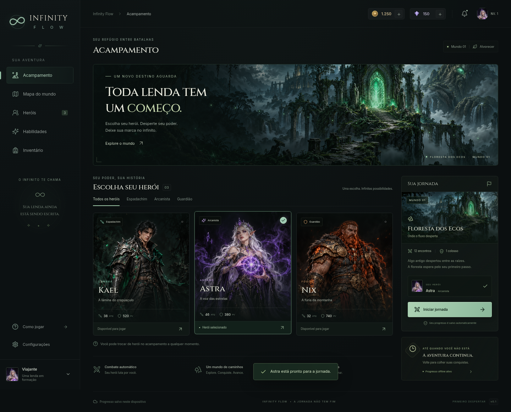

# Infinity Flow — Primeiro Despertar

RPG incremental em português brasileiro, para web e Android. Esta versão entrega o acampamento, três heróis ilustrados e a primeira região jogável, com combate automático, melhorias e progresso offline.



## Jogar e desenvolver

Requisitos: Node.js 22 ou superior.

```sh
npm ci
npm run dev
```

Abra o endereço indicado pelo Vite. Para produção:

```sh
npm test
npm run build
npm run preview
```

O build gera `dist/` com todos os recursos locais, fontes e um service worker. Após a primeira abertura e conclusão do cache, a versão web reabre sem internet. Não abra o HTML diretamente como `file://`; use o servidor local ou HTTPS.

## Primeira região

- Astra, Kael e Nix, com atributos e poderes diferentes; troca de herói no acampamento.
- Floresta dos Ecos, raça Umbral, 12 encontros e minichefes nos encontros 4 e 8.
- Vor’Kal no penhasco: rosto cortado pela borda da tela, laser ocular, abalo de terreno e queda animada antes da vitória.
- Combate automático a cada segundo, ataque por toque opcional e habilidade com recarga de 12 segundos.
- Melhorias de dano, vida e magia compradas com ouro, além de relíquia com cristais conquistados no jogo. Sem compras reais.
- Evolução visual nos níveis 5 e 10; melhorias também adicionam brilho, proteção e runas ao herói.
- Mapa em árvore: a vitória revela o próximo ramo. As outras regiões aparecem como conteúdo futuro, ainda sem batalhas próprias.
- Novos ciclos da primeira região com dificuldade crescente e nível sem máximo de design.

## Progresso e offline

O estado fica no armazenamento local deste navegador/aplicativo. Ao retornar, o motor simula até oito horas de combate automático, sem servidor nem processo rodando em segundo plano. A vitória do colosso aguarda confirmação para começar o próximo ciclo. Não há sincronização entre aparelhos.

A versão anterior, preservada em `legacy/web/`, usa `infinity-flow-salvo-v1`. Na primeira execução, o novo jogo migra esse progresso, se não existir um save novo, mantendo a chave antiga intacta. Configurações permitem exportar uma cópia JSON. Limpar os dados do navegador/aplicativo remove o progresso local.

## Android

O identificador permanece `br.com.anderflow.infinityflow`. Java 21 JDK e Android SDK 35 são necessários. Consulte [docs/ANDROID.md](docs/ANDROID.md).

```sh
./scripts/build-android.sh
```

O APK debug assinado, metadados e SHA-256 ficam em `artifacts/`. O workflow **Publicar Infinity Flow** também compila e disponibiliza o APK em GitHub Actions. Uma assinatura debug diferente da versão instalada impede atualização direta; preserve a chave de produção antes de distribuir uma versão comercial.

## Publicação e estrutura

- `src/App.tsx`: navegação, acampamento e configurações.
- `src/components/`: heróis, combate, mapa e melhorias.
- `src/game.ts`: combate, economia, progressão e migração.
- `src/useGame.ts`: persistência e retomada após ausência.
- `public/art/`: ilustrações originais produzidas para esta versão.
- `android/`: projeto nativo Capacitor.
- `tests/`: regressões de comportamento do motor.
- `docs/AGENTES.md`: critérios de qualidade do projeto.
- `docs/REFERENCE.md`: estudo de movimento e integração.
- `legacy/web/`: implementação anterior preservada.

O workflow web compila `dist/` a partir de `main` e o disponibiliza como artefato. Quando GitHub Pages estiver habilitado em Settings → Pages → GitHub Actions, também publica o site; o build respeita o caminho do repositório. As ilustrações são originais. O site meuclaudinho.com.br foi usado como referência de movimento, profundidade e resposta ao toque, sem reutilização de seus personagens ou recursos.

**Limite desta entrega:** primeira região completa e repetível. Mundos seguintes serão implementados e revisados individualmente. APK verificado por compilação, assinatura e conteúdo; a execução em aparelho físico é uma etapa de validação distinta.
